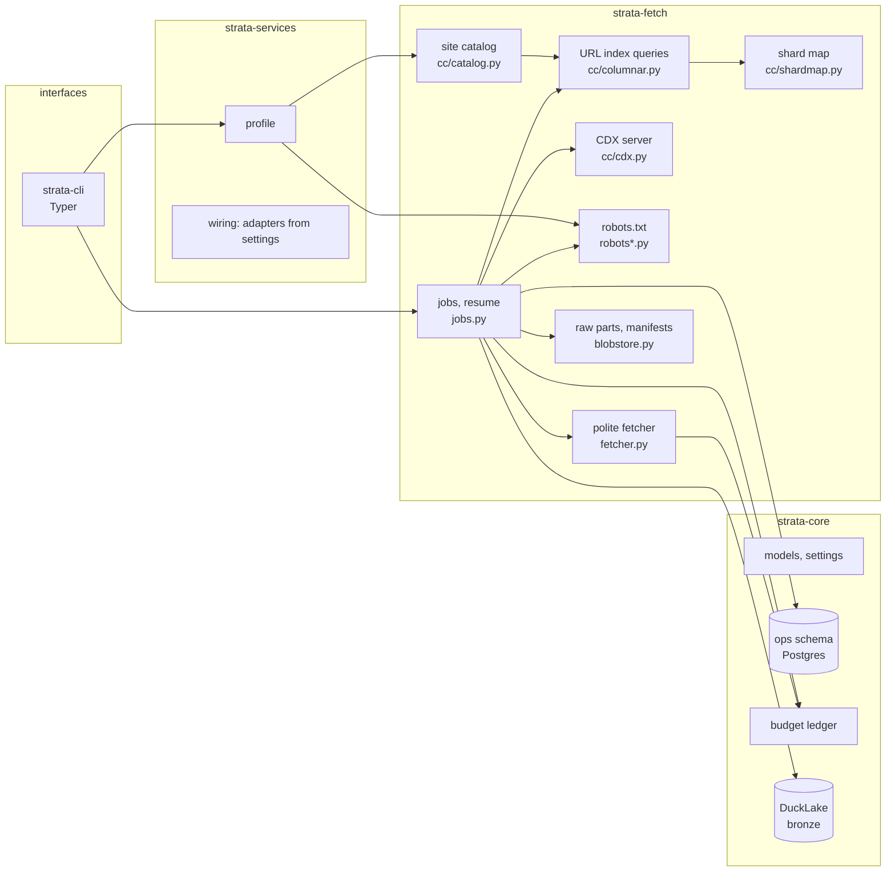

# Architecture

Strata answers questions about a site from Common Crawl's index, and pulls chosen pages from
Common Crawl's WARC files with proof of where every row came from. It never contacts the site
itself.

## Packages

Dependencies point one way, and the package boundaries enforce it (ADR-007). `strata-core`
holds models, settings and the stores; `strata-fetch` holds every adapter that talks to Common
Crawl or to storage; `strata-services` holds the use cases the interfaces call.

## Two paths

**Index only (profile, and next diff and changes).** No database. A site's captures in a crawl
are read once from the Parquet URL index into a site catalog, cached on disk; every later question
about the site runs on the catalog. The robots.txt evidence comes from the same crawl's
`robotstxt` subset. Requests are spent from an in-memory budget before they are sent.

**Jobs (run, gate1, and next pull).** Postgres holds the job, its budget ledger, every attempt
and every robots.txt decision. Pages are read by byte range from Common Crawl's WARC files,
verified, appended to a local part with a write-ahead manifest, sealed into the S3 store, and only
then written as bronze rows into DuckLake. A dead job resumes from its manifests.

## What each request passes through

1. **Budget before request.** The ledger (or the in-memory budget) reserves the request first.
   DuckDB's own requests are estimated from the shard map, reserved, then settled with the real
   count read back from DuckDB's HTTP log.
2. **Host gate.** A token bucket per host, a cap on requests in flight, and a pause for the whole
   host on 429 or 503 (`Retry-After` wins when longer). The rates are config (ADR-003).
3. **Honest User-Agent**, on our requests and on DuckDB's.
4. **Verification.** A WARC record must be one `response` whose URI and payload digest match
   the index (ADR-003).

## Decisions

- [ADR-001](adr/001-table-format.md) DuckLake with a Postgres catalog
- [ADR-002](adr/002-no-spark.md) No Spark: one DuckDB process covers the largest unit of work
- [ADR-003](adr/003-sourcing-policy.md) Sourcing policy
- [ADR-004](adr/004-index-sources.md) Index sources and how discovery fails
- [ADR-005](adr/005-object-storage.md) Object storage (RustFS)
- [ADR-006](adr/006-robots-verdicts.md) robots.txt verdicts
- [ADR-007](adr/007-code-layout.md) Code layout: a uv workspace, with the use cases in their own package
